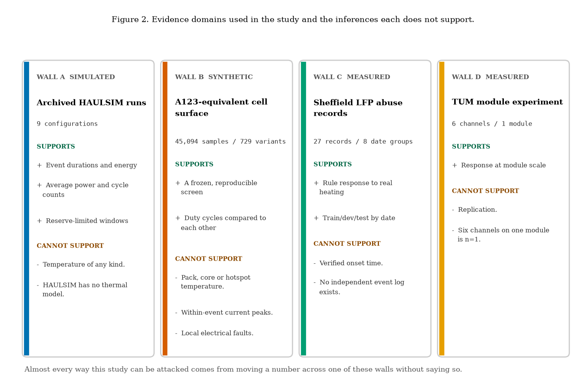
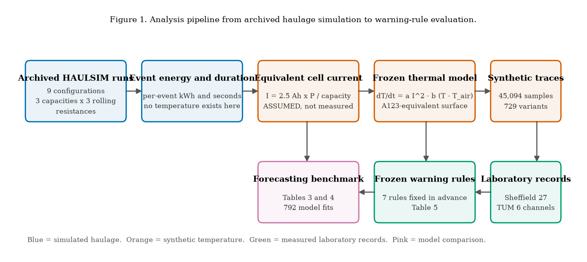
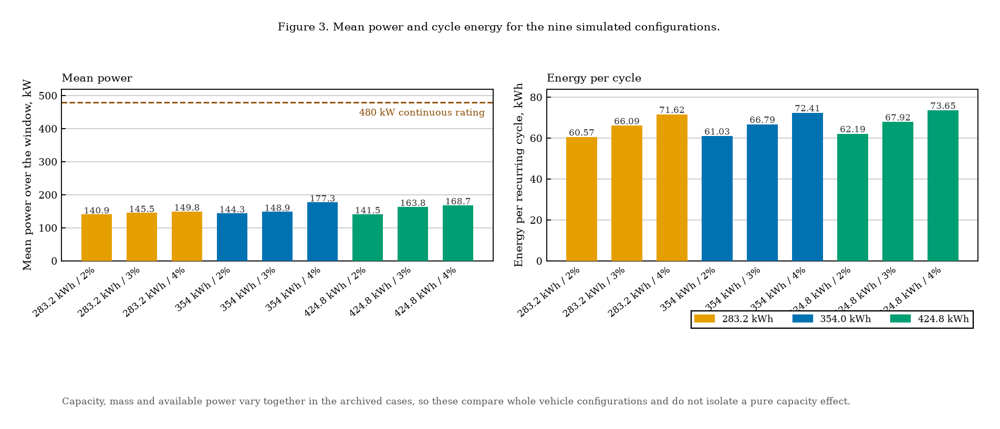
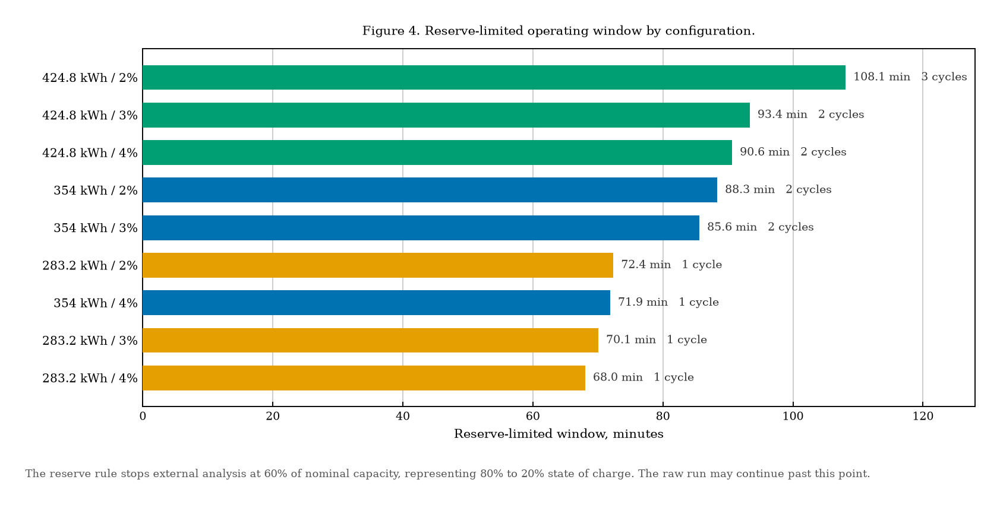
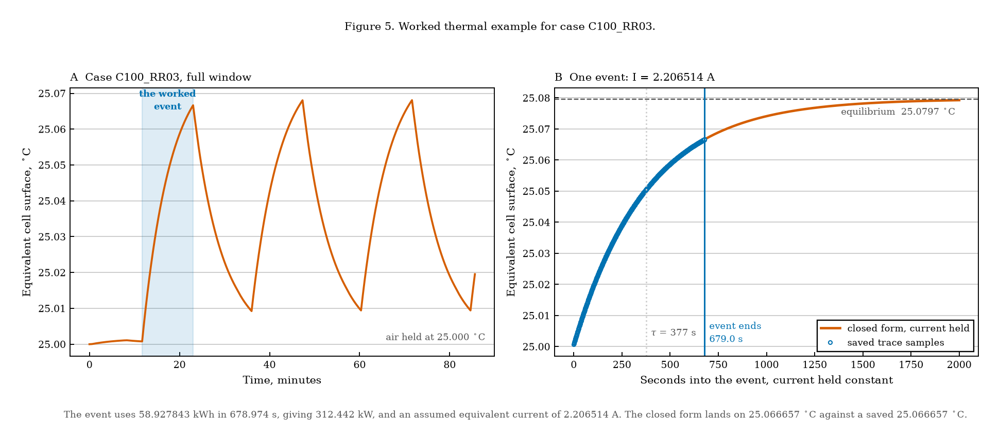
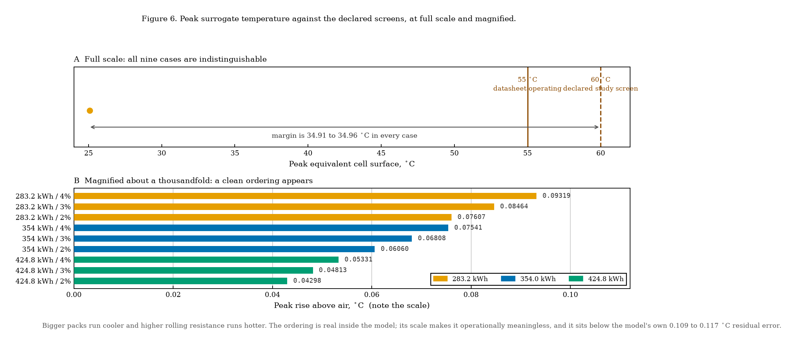
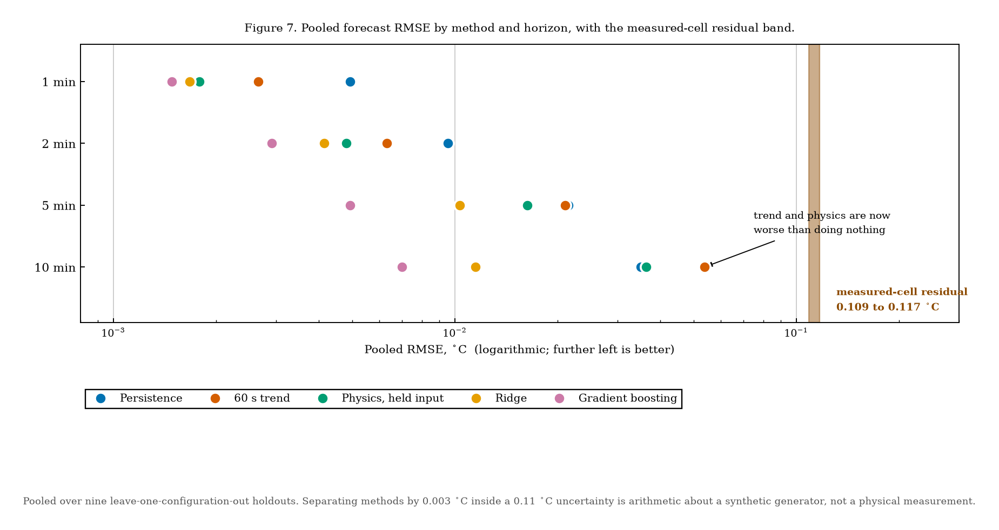
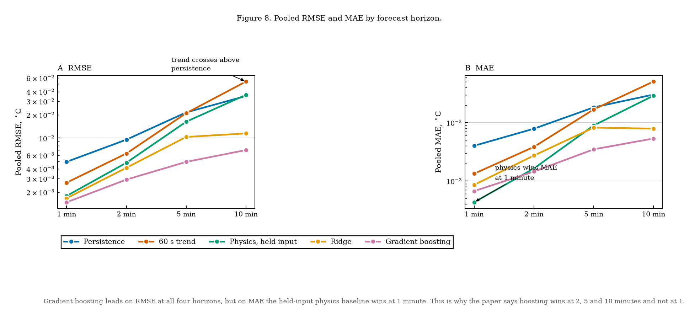
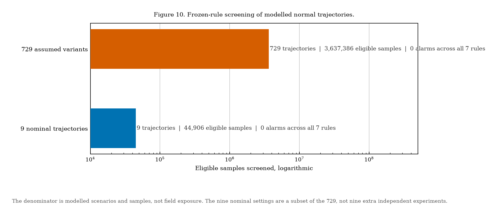
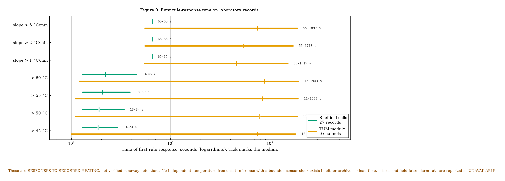

# Underground BEV thermal warning study

Simulation-informed thermal demand and a forecasting benchmark for battery
electric haul trucks in underground mining, using nine archived HAULSIM
configurations on a New Afton informed route, a fitted A123-equivalent cell
thermal model, and published LFP abuse records from Sheffield and TUM.

Bharti School of Engineering and Computation, Laurentian University.

> **Provenance.** The simulation outputs and laboratory records are genuine and
> reproducible. The analysis code, figures and documentation in this repository
> were produced with AI assistance, and the supporting conference paper draft
> was substantially AI-generated. See [`docs/PROVENANCE.md`](docs/PROVENANCE.md)
> for a component-by-component record and for what has been independently
> verified.

> **Temperatures here are A123-equivalent cell surface values from a fitted
> model.** They are not measured, and they are not validated Sandvik Z50 pack,
> core or hotspot temperatures. No verified thermal-runaway detection, lead time
> or field false-alarm rate is claimed anywhere in this work.

## What this study can and cannot support



Four separate bodies of evidence are used, and they are not interchangeable.
The integrity of every claim depends on not moving a number across one of these
boundaries without saying so.

| Domain | Supports | Does not support |
|---|---|---|
| Archived HAULSIM runs, 9 configurations | Event durations, energy, mean power, reserve windows | Temperature of any kind. HAULSIM has no thermal model. |
| A123-equivalent cell surface, 45,094 samples and 729 variants | A frozen, reproducible screen for comparing duty cycles | Pack, core or hotspot temperature; within-event peaks; local faults |
| Sheffield LFP records, 27 records over 8 date groups | Rule response to real recorded heating | Verified onset time. No independent event log exists. |
| TUM module experiment, 6 channels | Response at module scale | Replication. Six channels on one module is n = 1. |

## Analysis pipeline



## Results

### Haulage demand

Mean power ranges from 133 to 170 kW against the Z50's 480 kW continuous
rating, and each recurring cycle uses 60.6 to 73.7 kWh.



External analysis stops at an energy budget of 60 percent of nominal capacity,
representing 80 to 20 percent state of charge. Under that rule the configurations
run for 68 to 108 minutes and complete 1 to 3 recurring cycles.



### Worked thermal example

One loaded-haul event, native event Id 44 in `HS_EquipmentState`, case
`C100_RR03`. The closed-form solution reproduces the saved trace to
7.1e-14 degrees C.



```
energy             58.927843 kWh over 678.973851 s
event-average power   312.442421 kW          (65.1% of the 480 kW rating)
equivalent current      2.206514 A           ASSUMED, not measured
a = 4.344635e-05 K/(A^2 s)     b = 2.655463e-03 1/s     tau = 376.58 s
predicted end       25.066657 degrees C
saved trace         25.066657 degrees C
```

The equivalent current is constructed by matching power per unit of configured
energy, `I = 2.5 Ah * P / capacity`. It is **not** `P / V`: the pack voltage and
series/parallel topology are not identified. This assumption drives every
predicted temperature in the study and is its principal limitation.

### Thermal demand and the margin to the operating screen



Peak rise is 0.043 to 0.093 degrees C. The margin to the declared 60 degrees C
screen is 34.907 to 34.957 degrees C, a spread of 0.05 degrees C across all nine
configurations. Under these parameters, normal haulage duty cycle is not a
thermal risk pathway, and there is no meaningful margin comparison to draw
between configurations.

### Forecasting benchmark



Nine leave-one-configuration-out holdouts, four horizons, 792 model fits.
Gradient boosting leads on both error measures at 2, 5 and 10 minutes, **but not
at 1 minute**, where the held-input physics baseline wins on MAE.



Two results matter more than the ranking:

1. **The entire benchmark lies below the thermal model's own residual error.**
   The largest pooled RMSE is 0.054 degrees C; the measured-cell fit's held-out
   residual is 0.109 to 0.117 degrees C. Separating methods by 0.003 degrees C
   inside a 0.11 degrees C uncertainty is arithmetic about a synthetic
   generator, not a physical measurement.
2. **On measured data the ranking reverses.** These nine traces are the
   deterministic output of a known equation, so learned models recover that
   equation. On the measured A123 cell, persistence beats the learned models
   from 2 to 10 minutes. That reversal is the informative result.

At the 10 minute horizon both the trend baseline and the held-input physics
baseline become worse than persistence. The trend baseline extrapolates a
straight line onto a saturating exponential; the physics baseline freezes the
current while the duty cycle moves on.

### Warning rules

Seven rules fixed in advance: temperature above 45, 50, 55 and 60 degrees C, and
causal past-60-second slope above 1, 2 and 5 degrees C per minute, each
requiring 5 elapsed seconds.



No rule fires on any of the 729 modelled normal trajectories. The denominator is
modelled scenarios, not fleet exposure, and the nine nominal settings are a
subset of the 729 rather than nine additional experiments.



On laboratory records the same rules respond on 26 of 27 Sheffield records, all
7 test records, and all 6 TUM channels. **These are responses to recorded
heating, not verified runaway detections.** No independent, temperature-free
onset reference with a bounded sensor clock exists in either archive, so lead
time, missed detections and field false-alarm rate are reported as
`UNAVAILABLE` with a per-record reason in
[`data/manifest/event_register.csv`](data/manifest/event_register.csv).

## Reproducing this

```bash
pip install -r requirements.txt

python experiments/reproduce_thermal_chain.py     # rebuild the traces from inputs
python experiments/thermal_demand.py              # Table 2
python experiments/experiment_a_forecasting.py    # Tables 3 and 4
python experiments/experiment_b_warning_rules.py  # Table 5

python code/make_figures.py   # all ten figures
python code/verify.py         # 22 checks, non-zero exit on failure
python -m pytest tests/       # 37 unit tests
```

### How much of the pipeline actually reproduces

Reading a saved output is not the same as reproducing the work that made it, so
this repository is explicit about where it sits on that scale.

`reproduce_thermal_chain.py` rebuilds the published temperature traces from the
265-event haulage ledger, going through event-average power, the assumed
equivalent current and the frozen thermal model, touching the saved traces only
to compare at the end. It agrees to **7.1 × 10⁻¹⁵ °C** across all nine
configurations. That proves the traces follow from the stated inputs and the
stated equation with no undocumented step in between.

It does **not** validate the equivalent-current assumption, the fitted
coefficients, or the transfer from an A123 cell to a Z50 pack. A pipeline can be
exactly reproducible and still rest on an assumption that does not hold
physically. Two ends of the chain remain outside this repository: the HAULSIM
simulation that produced the event ledger needs a licensed copy of HAULSIM 3.8
build 585 and the native model files, and the fit that produced `a` and `b`
needs the A123 records. The fitting code is in
[`code/fit_thermal_model.py`](code/fit_thermal_model.py) and its provenance in
[`data/manifest/frozen_cell_model.json`](data/manifest/frozen_cell_model.json),
but the `.mat` records must be fetched from their DOI.

Everything reads from `data/derived/`, which is committed, so the experiments,
figures and checks all reproduce from this repository alone. Runs write to
`results/`, which is not committed, so a run never overwrites the archived
reference values. Licence-restricted source data is not included; see
[`data/README.md`](data/README.md) for the DOIs and the checksum manifest that
lets you confirm you have byte-identical inputs.

The forecasting models are implemented in numpy rather than imported, so the
repository reproduces the benchmark without scikit-learn and every modelling
choice is visible in the source. Reproducing the *original* fits instead needs
`scikit-learn==1.7.2` and `scipy==1.16.3` at seed `20261027`; see
[`requirements.txt`](requirements.txt).

## Repository layout

```
src/bev_research/
  config.py       frozen coefficients, screens, the experiment grid
  thermal.py      the lumped surface model, closed form and event replay
  features.py     causal 60 s window features
  baselines.py    persistence, linear trend, held-input physics
  models.py       ridge and gradient boosted trees, numpy only
  metrics.py      RMSE, MAE, and the resolution floor they sit against
  rules.py        the seven frozen warning rules
  datasets.py     loaders for the committed derived data
experiments/
  thermal_demand.py              Table 2
  experiment_a_forecasting.py    Tables 3 and 4
  experiment_b_warning_rules.py  Table 5
  README.md       what each experiment asks, finds, and does not establish
code/
  make_figures.py regenerates every figure
  verify.py       independent recomputation of the headline numbers
tests/            37 unit tests
data/
  derived/        computed outputs by experiment, committed (20 MB)
  manifest/       checksums and source metadata, committed
  raw/            licence-restricted source data, NOT committed
docs/
  PROVENANCE.md      who produced what, and what was verified
  FIGURE_CAPTIONS.md manuscript captions for every figure and table
figures/          ten figures, all from code/make_figures.py
```

## Status

Verification run on 28 October 2026: **22 of 22 checks pass**, and **37 of 37
unit tests pass**. The original experiment package reports a further 65 passing
software tests across the thermal, forecasting and laboratory branches.

The unit tests check physical and mathematical properties rather than just that
numbers appear: that the surface never overshoots its equilibrium, that one time
constant closes 1 − 1/e of the gap, that the causal slope cannot see a step
before it happens, that temperature carries between events instead of resetting
to air, that current is held piecewise-constant rather than interpolated, that
the ridge intercept stays unpenalised, and that the equivalent-current relation
remains the documented assumption rather than drifting toward `P / V`.

Open items: the equivalent-current assumption in Equation (2) needs explicit
justification, literature support and a sensitivity analysis; the reference list
needs restoring with proper support for the thermal modelling and machine
learning sections; author attribution and conference template compliance are
outstanding.

## Data attribution

See [`data/README.md`](data/README.md). In short: the TUM dataset
([10.14459/2023mp1717758](https://doi.org/10.14459/2023mp1717758)) declares no
licence and is not redistributed here; the Sheffield records are verified
against published checksums but not redistributed; HAULSIM is used under licence
from RPMGlobal and no licence or native model file is included. Third-party
rights remain with their owners.
